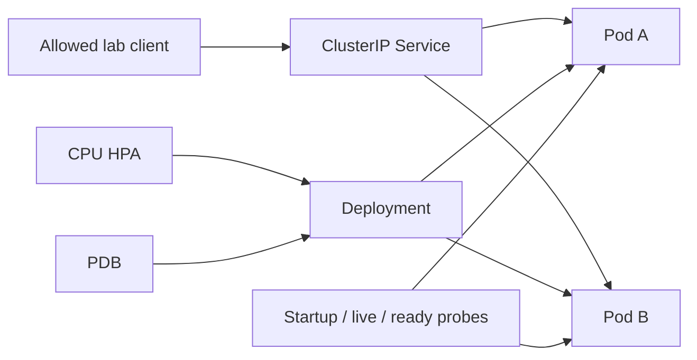

# Kubernetes Resilience Lab

A small, **local practice project** for Kubernetes reliability engineering. It pairs a dependency-free Python HTTP service with manifests that exercise health probes, graceful drain, rolling updates, a PodDisruptionBudget (PDB), CPU autoscaling, resource limits, and an ingress NetworkPolicy. The service includes Prometheus-format metrics and a bounded synthetic load generator.

This repository demonstrates configuration and reproducible tests. It has **not** been deployed to a production cluster and does not represent production availability, on-call work, or a measured service-level objective.

## What is here

| Component | Purpose |
| --- | --- |
| `app/service.py` | `/startupz`, `/livez`, `/readyz`, `/work`, and `/metrics`; synthetic 503 injection with `?fail=1` |
| `k8s/` | Kustomize base with a 2-replica Deployment, Service, HPA, PDB, and NetworkPolicy |
| `k8s/load-job.yaml` | Optional 2-minute CPU load Job for a cluster with resource metrics |
| `tools/load.py` | Bounded local load generator that prints HTTP counts and latency |
| `tools/check_manifests.py` | Renders manifests and checks probe paths, selectors, scaling, and drain settings |
| `tests/` | Dependency-free handler tests; no listening socket required |
| `docs/RUNBOOK.md` | Practice scenarios and troubleshooting steps |



## Run without Kubernetes

Requires Python 3.12 or newer. Runtime has no third-party Python packages.

```sh
python3 -m app.service
```

In a second terminal:

```sh
curl -i http://127.0.0.1:8080/readyz
curl -i 'http://127.0.0.1:8080/work?iterations=1000'
curl -i 'http://127.0.0.1:8080/work?iterations=1000&fail=1'
curl http://127.0.0.1:8080/metrics
python3 -m tools.load http://127.0.0.1:8080/work --seconds 5 --workers 2 --iterations 20000
```

`fail=1` is an explicit synthetic application failure. It increments the 503 counter but leaves `/readyz` healthy, because restarting a healthy process does not resolve an application-level error. For a readiness drill, create the file named by `DRAIN_FILE` (default `/tmp/krl-unready`); remove it to recover.

## Run in a local cluster

Requires Docker, `kind`, and `kubectl`. Build and load the image into the named kind cluster before applying the manifests because the Deployment deliberately uses `imagePullPolicy: Never`.

```sh
docker build -t resilience-lab:local .
kind create cluster --name resilience-lab
kind load docker-image resilience-lab:local --name resilience-lab
kubectl apply -k k8s
kubectl -n resilience-lab rollout status deployment/resilience-lab --timeout=120s
kubectl -n resilience-lab get pods,service,hpa,pdb,networkpolicy
```

To inspect the service from your workstation:

```sh
kubectl -n resilience-lab port-forward service/resilience-lab 8080:80
```

Then use the `curl` commands above. The NetworkPolicy allows ingress to service Pods only from Pods in the same namespace labeled `resilience-lab-access: "true"`. A CNI that enforces NetworkPolicy is required to test isolation; kind's default networking may not enforce it. Port forwarding uses Kubernetes control-plane plumbing and is not proof of NetworkPolicy enforcement.

### Autoscaling drill

The HPA needs a working resource metrics pipeline (commonly Metrics Server). Check that `kubectl top pods -n resilience-lab` returns CPU values before expecting scaling. Without that pipeline, the HPA can exist while CPU utilization shows `<unknown>`.

```sh
kubectl -n resilience-lab apply -f k8s/load-job.yaml
kubectl -n resilience-lab logs -f job/resilience-lab-load
kubectl -n resilience-lab get hpa -w
```

The Job runs for 120 seconds with eight workers and bounded CPU work. HPA decisions depend on cluster capacity, metrics sampling, and throttling; a specific replica count is **not** guaranteed. Run the Job again by deleting the completed Job first: `kubectl -n resilience-lab delete job resilience-lab-load`.

### Rolling update drill

```sh
kubectl -n resilience-lab set env deployment/resilience-lab STARTUP_DELAY_SECONDS=5
kubectl -n resilience-lab rollout status deployment/resilience-lab --timeout=180s
kubectl -n resilience-lab rollout undo deployment/resilience-lab
```

The rollout creates one extra Pod and waits for readiness before taking an old Pod out of service. The pre-stop hook marks the terminating Pod unready and waits eight seconds for endpoint changes to propagate. The 30-second termination grace period lets in-flight requests finish. Exact traffic behavior depends on the cluster and client connection reuse. The PDB protects voluntary evictions; it does not guarantee zero errors during every deployment or node failure.

## Verify locally

```sh
python3 -m venv .venv
. .venv/bin/activate
python -m pip install -r requirements-dev.txt
python -m unittest discover -s tests -v
python tools/check_manifests.py
```

The manifest check uses `kubectl kustomize` and PyYAML; it requires no cluster. CI also builds the image and smoke tests its endpoints in Docker. See [validation notes](docs/VALIDATION.md) for what was actually run when this project was prepared.

## Design choices and limits

- Distinct startup, liveness, and readiness endpoints let Kubernetes wait for startup, restart a nonresponsive process, and remove an unready Pod from Service endpoints.
- The container runs as a non-root user with a read-only root filesystem, dropped capabilities, and a writable 16 MiB `/tmp` volume for the drain marker.
- The HPA uses CPU utilization against a `100m` request and ranges from two to four replicas. It does not autoscale from the app's Prometheus metrics.
- `/metrics` is available for Prometheus scraping, but this repository does not install Prometheus, alert rules, or a monitoring stack. The ingress policy must explicitly permit a scraper Pod before remote scraping works.
- This is intentionally a lab service. It does not include authentication, persistent state, an ingress controller, or a cloud environment.

See [the runbook](docs/RUNBOOK.md) for concrete drills and recovery steps.

## License

MIT. See [LICENSE](LICENSE).
